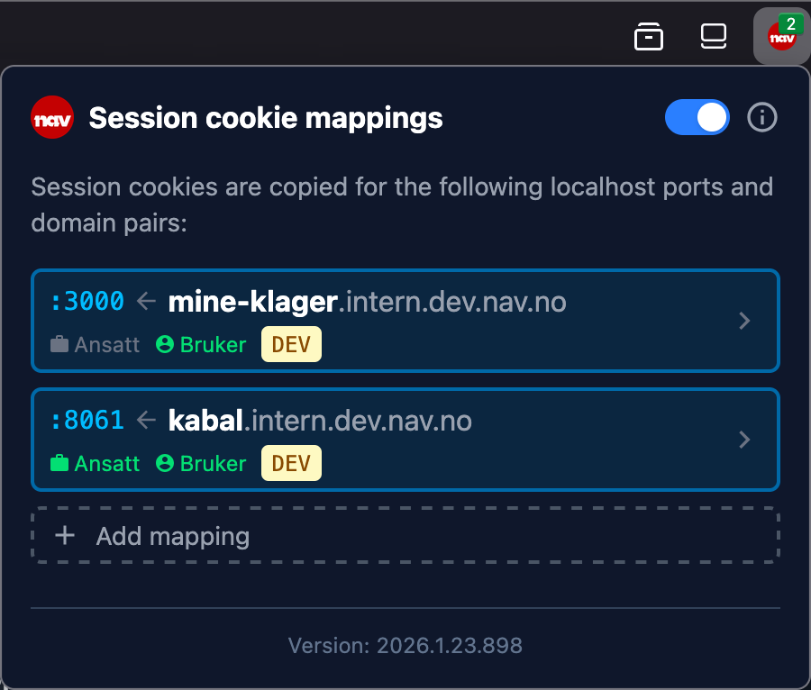

# Nav Dev Sessions Extension

Browser extension that copies session cookies to requests for easier development against `dev` and `prod` environments, from a `localhost` environment.

_**:warning: Chrome and Edge do NOT support modifying WebSocket headers.**_

_**:white_check_mark: Firefox DOES support modifying WebSocket headers.**_

## Firefox (Recommended)

[-FF7139?logo=firefox-browser&logoColor=white)](https://github.com/cskrov/nav-dev-sessions-extension/releases/latest/download/nav_dev_sessions_extension-firefox.xpi)

_Single-click install, automatic updates and WebSocket support!_

## Chrome and Edge

[-4285F4?logo=googlechrome&logoColor=white)](https://github.com/cskrov/nav-dev-sessions-extension/releases/latest/download/nav_dev_sessions_extension-chrome.zip)
[-0078D7?logo=)](https://github.com/cskrov/nav-dev-sessions-extension/releases/latest/download/nav_dev_sessions_extension-edge.zip)

1. Download
2. Unzip
3. Go to `chrome://extensions` or `edge://extensions`
4. Enable developer mode
5. Click "Load unpacked"
6. Select `manifest.json`

## Screenshot



## Requirements

- Your application in NAIS must offer the endpoints needed by your local application.
  - Proxy requests to any API endpoints used by your application.
- Your local development server must proxy requests to NAIS.

## How to use

1. Install the extension for your browser (Firefox, Chrome, or Edge).
2. Open `dev` or `prod` in one tab and log in.
3. Open your `localhost:<port>` application in another tab.
4. Add a mapping from the `dev` or `prod` domain to `localhost:<port>`.
   - The extension will detect the last active `localhost` port automatically.
5. Enjoy seamless authentication for your `localhost` application!
   - Continue to use `dev` or `prod` in the first tab as normal.

## Features

- Allows multiple `localhost` ports to be mapped at the same time.
- Detects the last active `localhost` port automatically when adding new mappings.
- Remembers which domains are associated with which `localhost` ports.
- Allows easy switching between domains for different `localhost` ports.
- Mappings can be removed when no longer needed.
- The whole extension can easily be disabled/enabled with a single click.

## Copied cookies

- `io.nais.wonderwall.session` - Employee session cookie (works on all `*.nav.no` domains)
- `sso-dev.nav.no` - End user session cookie for `dev` domains (`*.dev.nav.no`)
- `sso-nav.no` - End user session cookie for `prod` domains (`*.nav.no`, excluding `*.dev.nav.no`)

## Domains covered

All requests to mapped `localhost` ports will have the session cookies added.

### Only if mapped from `dev` domain

- `login.ekstern.dev.nav.no`
- `dekoratoren.ekstern.dev.nav.no`

### Only if mapped from `prod` domain

- `login.nav.no`
- `www.nav.no`

### For what architectures this extension makes sense

1. A browser app (React+Vite, NextJS etc.) - that you want to run locally
2. A BFF application in NAIS
3. One or more APIs/services with auth in NAIS your local app needs to reach

The local dev server (Vite, NextJS etc.) must direct all requests to the BFF in NAIS.

- It must proxy all relevant requests from the browser.
- Server-side requests must go to your NAIS BFF application.

The BFF application in NAIS must:

- Proxy the upstream APIs/services.

#### React + Vite application example

Kabal is a React application built with Vite and a small BFF built with Fastify.

When the Kabal app is run in `dev` and is served from `https://kabal.intern.dev.nav.no`, the BFF in NAIS proxies requests to a few APIs, handling OBO-tokens on the way.

When the Kabal app is run locally and is served from `http://localhost:5173`, the Vite dev server receives these requests instead.

> Example request `GET /api/kabal-api/behandlinger/05794b15-4c01-427d-8855-7bc134bb7b95`.

The Vite dev server proxies these requests to `https://kabal.intern.dev.nav.no`.

> Example proxy request `GET https://kabal.intern.dev.nav.no/api/kabal-api/behandlinger/05794b15-4c01-427d-8855-7bc134bb7b95`

The BFF receives these proxy requests from the local Vite dev server and requires the same cookies as from the requests from `https://kabal.intern.dev.nav.no`.

##### Request flow

```
Browser (localhost:5173)
  │
  │  GET /api/kabal-api/behandlinger/05794b15-...
  │  (extension adds session cookies from dev to this request)
  │
  ▼
Vite dev server (localhost:5173)
  │
  │  Proxies /api/* → https://kabal.intern.dev.nav.no/api/*
  │  GET https://kabal.intern.dev.nav.no/api/kabal-api/behandlinger/05794b15-...
  │  (cookies are forwarded with the proxied request)
  │
  ▼
BFF in NAIS (kabal.intern.dev.nav.no)
  │
  │  Validates session cookie
  │  Exchanges token (OBO) for downstream API
  │
  ▼
Downstream API (kabal-api)
```

##### Vite config example

```js
  server: {
    proxy: {
      '/api': {
        target: 'https://your-app.intern.dev.nav.no',
        changeOrigin: true,
      },
    },
  },
```

#### NextJS application example

Kaptein is a NextJS application, with both client-side API requests and server-side API requests.

When Kaptein is run in `dev` and is served from `https://kaptein.intern.dev.nav.no`, the NextJS server in NAIS proxies client-side requests and makes server-side requests to downstream APIs, handling OBO-tokens on the way.

When Kaptein is run locally and is served from `http://localhost:3000`, there is no Wonderwall and no APIs are reachable by service name (eg. `kaptein-api`). All requests must go through the BFF in NAIS instead.

There are two types of requests to handle:

1. **Client-side requests** — Browser fetches (eg. `GET /api/kaptein-api/data`) must be proxied by the local NextJS dev server to `https://kaptein.intern.dev.nav.no`.
   > Example: `GET /api/kaptein-api/data` → `GET https://kaptein.intern.dev.nav.no/api/kaptein-api/data`

   NextJS rewrites handle this. The extension adds the session cookies to the browser request, and NextJS forwards them with the proxied request.

2. **Server-side requests** — Server components and route handlers make `fetch` calls directly. These must target the BFF in NAIS (eg. `https://kaptein.intern.dev.nav.no/api/kaptein-api/data`) and manually forward the session cookies from the incoming request.

   The extension adds the session cookies to the initial page request from the browser. Your server-side code must read these cookies and include them in the outgoing `fetch` call.

This may require public API endpoints in `dev` for local development. They do not need to be exposed in production.

The BFF will require the same cookies for the proxied requests from the local dev server as from the requests from `https://kaptein.intern.dev.nav.no`.

##### Client-side request flow (browser → API)

```
Browser (localhost:3000)
  │
  │  GET /api/kaptein-api/data
  │  (extension adds session cookies from dev to this request)
  │
  ▼
NextJS dev server (localhost:3000)
  │
  │  Rewrites /api/* → https://kaptein.intern.dev.nav.no/api/*
  │  GET https://kaptein.intern.dev.nav.no/api/kaptein-api/data
  │  (cookies are forwarded with the proxied request)
  │
  ▼
BFF in NAIS (kaptein.intern.dev.nav.no)
  │
  │  Validates session cookie
  │  Exchanges token (OBO) for downstream API
  │
  ▼
Downstream API (kaptein-api)
```

##### Server-side request flow (NextJS server component / route handler → API)

```
Browser (localhost:3000)
  │
  │  GET /some-page
  │  (extension adds session cookies from dev to this request)
  │
  ▼
NextJS dev server (localhost:3000)
  │
  │  Server component or route handler runs
  │  Reads cookies from the incoming request
  │  Makes fetch to https://kaptein.intern.dev.nav.no/api/kaptein-api/data
  │  (must forward cookies in the fetch call)
  │
  ▼
BFF in NAIS (kaptein.intern.dev.nav.no)
  │
  │  Validates session cookie
  │  Exchanges token (OBO) for downstream API
  │
  ▼
Downstream API (kaptein-api)
```

> **Key difference**: For client-side requests, NextJS rewrites handle proxying and cookies flow automatically. For server-side requests, your code must read the cookies from the incoming request and explicitly forward them in the `fetch` call to the BFF.

## Why make this extension?

Manually moving or copying session cookies from `dev` or `prod` to `localhost` is a hassle.
The easiest way is to change the domain of the session cookie, which moves the cookie from `*.dev.nav.no` or `*.nav.no` to `localhost`.

Moving is especially problematic because `dev`/`prod` will set a new session cookie for `*.dev.nav.no` or `*.nav.no`, and invalidate the session cookie for `localhost` the next time you interact with `dev`/`prod`.

This extension automatically adds the session cookies from `dev`/`prod` to all requests to `localhost`. You can and should have both `dev`/`prod` and `localhost` open at the same time, to keep your session alive.

## Build

1. Install [Bun](https://bun.sh)
2. Install dependencies - `bun i`
3. Build the extension - `bun run build`

The built extension will be in the `/dist` directory.

## Package

_You must build the extension before packaging it._

### Firefox

`bun run firefox:pack`

### Chrome

`bun run chrome:pack`

### Edge

`bun run edge:pack`

The packed extension will be in the `/dist` directory.

## Sign

### Firefox

`WEB_EXT_API_KEY` and `WEB_EXT_API_SECRET` can be obtained from the [Firefox Add-on Developer Hub](https://addons.mozilla.org/en-US/developers/addon/api/key/).
